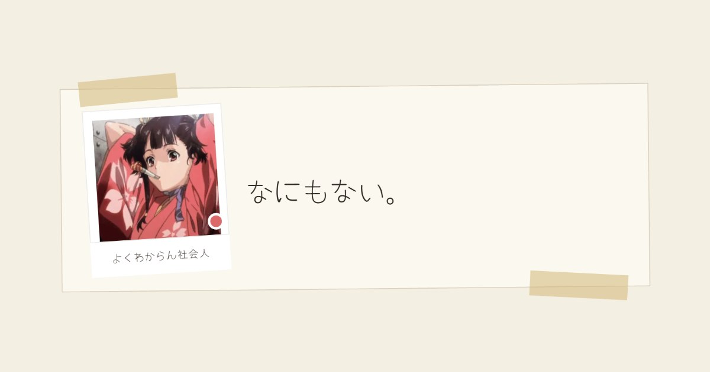

# Pooのくそさいと

https://poo123.com/

※AI(Claude)がすべて作ってます。人間がコードに全然関与していません！！！！！！😍

うんちさんが むだに買ったドメインで 遊んでいる個人サイト。
紙とマスキングテープの見た目をしていて、中身は とくにない。



---

## なにが のっているか

| ところ | なかみ |
| --- | --- |
| じぶん | 写真と チェックリスト |
| いま | Discord のようす。オンライン状態・やっていること・聴いているものが **そのまま動く** |
| きょうの ひとこと | 日替わりの一行 |
| さわったことあるやつ | さわった言語のシール |
| すきな ごはん | レシート |
| ほしいもの | ほしいものを 短冊に ならべた 札 |
| よくある しつもん | 開いて閉じるやつ |
| りんく | 各サービスへの 切り抜き |
| そら | 見出しの したの 一行。**新宿の いまの 天気**が そのまま 出る |

ページが見つからないときは `404.html`（下が破れた紙）が出る。

スマホでは、下までスクロールすると 右下に **丸いボタン**が出る。
押すと ページの中を いどうする 丸いふだが 下から ならぶ。

見出しを 通りすぎると、うえに 名まえだけの 細い帯が すべりこむ。

---

## ひると よる

右上の まるい はんこで 切りかえる。選んだら おぼえておく。

**まだ 選んでいない人**には、新宿で 日が しずんでいるかどうかで 決める。
いちど 自分で 押した人の 設定は 上書きしない。

| | ひる | よる |
| --- | --- | --- |
| 紙 | 生成り `#f4efe3` | 夜空 `#070b1c` |
| 文字 | すみ `#2f2823` | 月あかり `#e3ebff` |
| 空 | — | 左うえに 月、右したに 沈んだ 雲 |

よるだけ 出るもの:

- **蛍** — 16匹（スマホは9匹）。16〜30秒で ながれ、2.6〜5.4秒で 明滅する。
  出る 場所・大きさ・速さ・位相は ぜんぶ ばらばらに ずらしてある
- **雲** — 5枚（スマホは3枚）。2分半〜4分半かけて 右から 左へ。
  かたまりを 4つ ずらして 重ねた もやで、**まんなかが 月より 暗く、そとが 空より 明るい**。
  これ 1枚で「空では 雲に 見えて、月に かかると かげに なる」の 両方が 起きる
- **月の 息づかい** — 23秒かけて 明るさが ゆっくり 変わる

ひるに もどすと 蛍も 雲も 捨てる。見ていない あいだ CPU を つかわない。

---

## そら（本当の 天気）

[Open-Meteo](https://open-meteo.com/) から **新宿**（35.6938 / 139.7036）の
いまの 天気を とってきて、背景に 出す。鍵も 登録も いらない。

| 天気 | でるもの |
| --- | --- |
| あめ | 雨粒が 70本 ふる |
| ゆき | 雪が 60粒 まう |
| くもり | 空が すこし 重くなる。よるは 雲が こくなる |
| はれ | 空が すこし 明るくなる。よるは 雲が うすくなる |

たまに 通りすぎるもの（風船・紙ひこうき・木の葉・しゃぼん玉／よるは 蛾・流れ星）も
天気を 見ている。**あめと ゆきの日は 風船と しゃぼん玉を 出さず、間も あける。
雲が あるときは 流れ星を 出さない。**

---

## 余白の 紙きれ

ひろい画面（1180px より うえ）の 左右に、半券・レシート・写真・ふせんが
画面の そとに はみ出して 貼ってある。ゆっくり 上下に ゆれる。

はみ出す量は 固定ではなく `min()` で 画面のはばから 決める。
ひろい画面では 85〜90% 見えて、せまくなるほど 外へ にがす。
いちばん せまい 1180px でも 本文との すきまは 34px 以上。

---

## ファイルの ならび

```
.
├── index.html       ページ本体 ＋ Discord 埋め込みの定義
├── style.css        見た目ぜんぶ（紙・テープ・風・アニメーション）
├── script.js        Discord 連携・日替わり文・スクロール演出・飛んでくるもの
├── 404.html         ページが ないときの紙
├── photo/           画像（アイコン / 埋め込み用 / OGP / favicon）
├── wrangler.jsonc   Cloudflare Workers の設定
├── .assetsignore    配信しないファイルの一覧
└── README.md        これ
```

ビルドは いらない。素の HTML・CSS・JavaScript だけで、依存パッケージもない。

---

## Discord のようす（いま）

[Lanyard](https://github.com/Phineas/lanyard) の WebSocket（`wss://api.lanyard.rest/socket`）に
つないで、届いたものを そのまま紙の上に出している。キーは いらない。

出しているもの:

- オンライン状態（オンライン / はなれてる / とりこみ中 / いない）
- アバターと **アバターデコレーション**
- **ネームプレート** — 動く版（`asset.webm`）を再生。
  透けている部分があるので、流れはじめたら 下の静止画は どける。
  読めなかったときだけ 静止画（`static.png`）に もどる
- **サーバータグ** — 名前の右に Discord とおなじ並びで
- やっていること（ゲーム / 動画 / 音楽 / 配信 / 参戦）
  - **2件まで**出して、あまったぶんは「ほかに ◯ こ」でたたむ
  - 終わりの時刻がわかるもの（音楽・動画）は **再生バーと 再生位置**を出す
  - 活動の画像は 直リンクだと断られることがあるので
    `media.discordapp.net` 経由で もらっている

> Lanyard を使うには、Lanyard の Discord サーバーに 入っている必要がある。

「動きを減らす」設定（`prefers-reduced-motion`）のときは、
動くネームプレートも 飛んでくるものも 止まる。

---

## Discord に貼ったときの埋め込み

`index.html` の中の

```html
<script id="discord:component-embed" type="application/json">
```

が それ。Discord の Components v2 で、見出し・説明・アイコン・画像・ボタンを並べている。

きまりごと:

- 部品は **40個**まで、全体で **3,000バイト**まで
- ボタンは 1行に **5個**まで
- 画像は PNG / GIF / JPEG / WebP / AVIF

X や LINE に貼ったときは、`og:image` に指定した `photo/ogp.jpg`（1200×630）が出る。

---

## うごかしかた

静的ファイルだけなので、置いて開けば うごく。

```sh
npx serve .
```

Cloudflare へは `main` に push すると 自動で出る（Workers Builds）。
手でやるなら:

```sh
npx wrangler deploy
```

`.assetsignore` に書いたもの（`.git` / `README.md` / `wrangler.jsonc` など）は
配信されないので、ブラウザから 中は見られない。

---

## うごきを へらす設定のとき

OS で「視差効果を減らす」を 入れている人には、
蛍・雲・雨・雪・紙きれの ゆれ・通りすぎるもの を ぜんぶ 出さない。
色と 中身は そのまま。

---

## つかっているもの

- [Cloudflare Workers](https://developers.cloudflare.com/workers/static-assets/) — 静的アセットの配信
- [Lanyard](https://github.com/Phineas/lanyard) — Discord のようす
- [Open-Meteo](https://open-meteo.com/) — 新宿の 天気（鍵なし）
- [Google Fonts](https://fonts.google.com/) — Yomogi / Zen Kurenaido / Caveat
- [Font Awesome](https://fontawesome.com/) — アイコン

---

## ことわり

コードは 好きに見てもらって かまわないけれど、
写真・アイコン・本文は 本人のものなので、そのまま使うのは やめてほしい。
